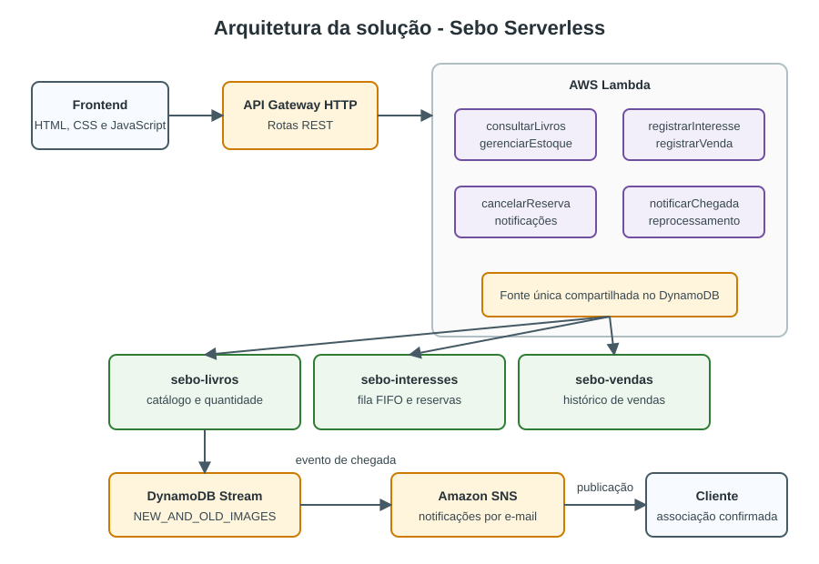

# Sebo serverless na AWS

Aplicação de sebo desenvolvida para o Trabalho 2 de Distribuição e Concorrência da PUC-Rio, período 2026.2. O projeto permite consultar o catálogo, cadastrar livros e registrar interesses em exemplares indisponíveis. Conforme o estoque muda, o sistema organiza os interessados em uma fila FIFO e reserva unidades automaticamente.

## Integrantes

| Nome completo | Matrícula |
|---|---|
| Matheus Figueiredo | 2320813 |
| João Marcelo de Onofre Fontes Teixeira | 2310397 |
| João Pedro Feijoo | 2311603 |

## Tecnologias utilizadas

- HTML, CSS e JavaScript para o frontend estático.
- Python nas seis funções AWS Lambda.
- Amazon API Gateway HTTP API.
- Amazon DynamoDB com as tabelas `sebo-livros`, `sebo-interesses` e `sebo-vendas`.
- DynamoDB Streams para acompanhar aumentos no estoque.
- Amazon SNS para publicar notificações por e-mail.

## Funcionalidades

- Consulta e busca de livros no catálogo.
- Cadastro de livros e atualização da quantidade em estoque.
- Registro de interesse em livros disponíveis ou indisponíveis.
- Organização dos interessados por ordem de registro em uma fila FIFO por livro.
- Reserva automática de uma unidade para o primeiro interessado elegível.
- Envio de notificações por e-mail por meio do SNS.
- Reprocessamento manual de notificações pendentes ou com falha.
- Registro de venda de uma reserva.
- Venda de balcão usando somente estoque disponível.
- Cancelamento de reservas e transferência da unidade para o próximo interessado.
- Consulta das vendas e dos interesses de cada livro.

Os interesses podem ficar com os estados `AGUARDANDO`, `RESERVADO`, `VENDIDO` ou `CANCELADO`. Uma reserva não expira automaticamente: ela permanece ativa até uma venda ou um cancelamento feito pelo colaborador.

## Arquitetura

O frontend chama o API Gateway HTTP, que encaminha cada rota para a Lambda correspondente. As Lambdas consultam ou alteram as tabelas DynamoDB.

Quando o estoque aumenta, o DynamoDB Stream envia a alteração para `sebo-notificarChegada`. Essa Lambda reserva as unidades para os primeiros interessados e publica os avisos no SNS.

<p align="center">
  
</p>

As seis funções são `sebo-consultarLivros`, `sebo-gerenciarEstoque`, `sebo-registrarInteresse`, `sebo-notificarChegada`, `sebo-registrarVenda` e `sebo-cancelarReserva`.

## Organização do repositório

```text
README.md
docs/
  relatorio-final.md
.env
src/
  frontend/
    index.html
    estilos.css
    app.js
    config.js
  lambdas/
    consultar_livros/
    gerenciar_estoque/
    registrar_interesse/
    notificar_chegada/
    registrar_venda/
    cancelar_reserva/
    comum/
  scripts/
    preparar_frontend.py
```

## Como executar

1. Configure no AWS Academy as tabelas, as seis Lambdas, o DynamoDB Stream, o tópico SNS e as rotas do API Gateway. Os recursos não têm deploy automatizado.
2. Configure a variável `API_GATEWAY_URL` no arquivo `.env` com a URL base da implantação HTTP API.
3. Gere o arquivo usado pelo navegador:

```powershell
python src/scripts/preparar_frontend.py
```

4. Abra `src/frontend/index.html` no navegador ou sirva essa pasta com um servidor estático.

O projeto já contém no `.env` e em `src/frontend/config.js` a URL da implantação usada no desenvolvimento. Não há backend local simulado para executar.

## Documentação

O relatório completo está em [docs/relatorio-final.md](docs/relatorio-final.md).

## Limitações

Os endpoints administrativos não possuem autenticação ou autorização. A execução depende da disponibilidade do AWS Academy Learner Lab e das credenciais temporárias do laboratório. Os destinatários precisam confirmar a inscrição no SNS, e a publicação pelo SNS não garante a entrega efetiva do e-mail. O projeto não foi preparado para uso de produção e não implementa expiração automática das reservas.
