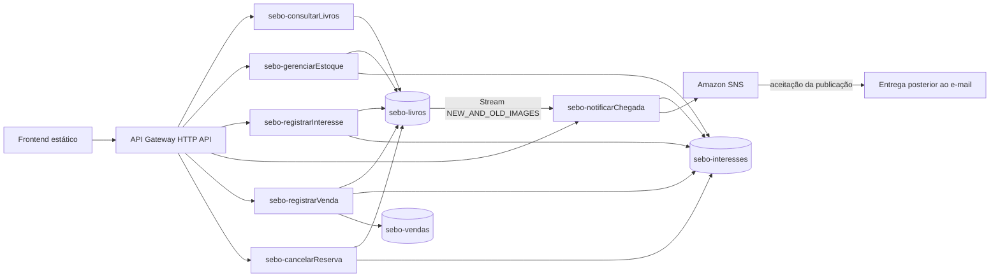
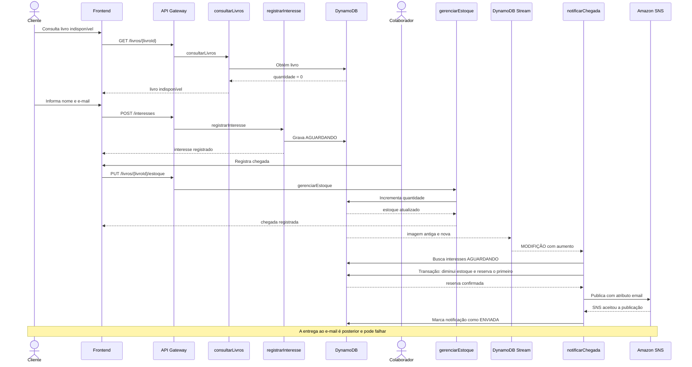

# Trabalho 2 - Aplicação de Sebo Serverless

## Identificação

PUC-Rio  
Distribuição e Concorrência  
Período 2026.2

Título do trabalho: aplicação de sebo com fila de interesses e reservas na AWS.

| Nome completo | Matrícula |
|---|---|
| Matheus Figueiredo | 2320813 |
| João Marcelo de Onofre Fontes Teixeira | 2310397 |
| João Pedro Feijoo | 2311603 |

## 1. Introdução e objetivo

Neste trabalho implementamos uma aplicação para um sebo de livros usados. O objetivo foi permitir que clientes consultem o catálogo e registrem interesse em exemplares indisponíveis, enquanto colaboradores cadastram livros, controlam o estoque e registram vendas.

Quando um livro está em falta, não é suficiente apenas guardar uma solicitação. Precisamos manter uma ordem de chegada, reservar uma unidade ao primeiro interessado elegível e informar esse cliente. Depois da reserva, o sistema precisa impedir que o mesmo exemplar seja vendido ou cancelado por operações concorrentes. O catálogo, os interesses e as vendas ficam separados em tabelas DynamoDB, e as operações do colaborador são disponibilizadas pelas mesmas Lambdas usadas pelo frontend.

## 2. Arquitetura da solução

Utilizamos um frontend estático em HTML, CSS e JavaScript. Ele consulta o API Gateway HTTP, que encaminha as requisições para uma das Lambdas pelo `routeKey` recebido no payload do HTTP API 2.0.

As seis Lambdas implementadas são:

- `sebo-consultarLivros`: lista o catálogo e obtém os dados de um livro. Também calcula se o livro está disponível a partir da quantidade.
- `sebo-gerenciarEstoque`: cadastra livros, registra chegadas por incremento no estoque e lista os interessados de um livro.
- `sebo-registrarInteresse`: grava um cliente na fila e tenta reservar imediatamente um exemplar caso o livro já esteja disponível.
- `sebo-notificarChegada`: é acionada pelo DynamoDB Stream quando o estoque aumenta e reserva unidades para os interessados; também oferece o reprocessamento manual de notificações.
- `sebo-registrarVenda`: registra venda de uma reserva ou venda de balcão e grava o resultado na tabela de vendas.
- `sebo-cancelarReserva`: cancela uma reserva ativa, devolve uma unidade ao estoque e tenta reservar essa unidade para o próximo interessado.

As tabelas usadas são:

- `sebo-livros`: chave `livroId`, com título, autor, preço, conservação, quantidade e data da última chegada.
- `sebo-interesses`: chave composta por `livroId` e `email`, com nome, estado, data de criação, dados da reserva e estado da notificação.
- `sebo-vendas`: chave `vendaId`, com livro, valor, data e, quando aplicável, e-mail do cliente e colaborador.

O DynamoDB Stream da tabela de livros é configurado com imagens antiga e nova. A Lambda de chegada compara as quantidades e processa o aumento. O Amazon SNS recebe o aviso publicado pela fila compartilhada e usa o atributo de mensagem `email` para selecionar uma assinatura com a política correspondente.

## 3. Implementação e funcionamento

No catálogo, o frontend permite buscar por título ou autor. A Lambda `sebo-consultarLivros` retorna os livros cadastrados e adiciona o campo de disponibilidade conforme a quantidade em estoque.

A Lambda `sebo-gerenciarEstoque` permite cadastrar um livro com quantidade inicial ou zero. Na chegada de exemplares, ela usa um incremento do próprio DynamoDB, sem ler e gravar uma quantidade calculada no código. Esse incremento gera eventos no Stream da tabela e é a base para a chamada assíncrona da Lambda de chegadas.

Ao registrar interesse, o sistema normaliza o e-mail para minúsculas e usa a chave composta das tabelas. Um pedido repetido não substitui a posição já criada: o item original é mantido quando o interesse ainda está em `AGUARDANDO` ou `RESERVADO`. Para evitar perder o interesse em uma intercalação com uma chegada, o registro na fila é feito antes da leitura final do estoque.

Os estados dos interesses são:

- `AGUARDANDO`: o cliente está na fila sem unidade reservada.
- `RESERVADO`: uma unidade foi reservada para o cliente.
- `VENDIDO`: a reserva foi confirmada como venda.
- `CANCELADO`: a reserva foi cancelada pelo colaborador.

Os interessados são ordenados pela data `criadoEm` e pelo e-mail como desempate. O módulo compartilhado consulta os itens em `AGUARDANDO` e tenta reservar o primeiro elegível em uma transação. Se a reserva condicional não puder ser feita, a execução continua para o próximo interessado.

Uma unidade reservada já é descontada da quantidade em `sebo-livros`. Portanto, vender essa reserva muda o interesse para `VENDIDO`, mas não desconta novamente o estoque. A venda de balcão não recebe e-mail nem reserva: ela apenas atualiza a quantidade do livro e exige `quantidade >= 1` na transação.

No cancelamento, o sistema valida o estado `RESERVADO` e, opcionalmente, o `reservaId`. Depois ele volta uma unidade ao estoque e muda o interesse para `CANCELADO` na mesma transação. Em seguida, tenta reservar essa unidade para o próximo interessado elegível.

As reservas não têm prazo de expiração configurado. Permanecem em `RESERVADO` até o colaborador confirmar uma venda ou cancelar a reserva.

Para notificações, o sistema usa os estados `PENDENTE`, `ENVIANDO` e `ENVIADA`. A publicação no SNS é condicionalmente confirmada no item do interesse. Falhas de publicação fazem o estado voltar para `PENDENTE`, permitindo reprocessamento manual pela rota `POST /notificacoes/reprocessar`. Esse reprocessamento exige uma reserva ativa e não cria uma nova reserva.

## 4. Concorrência e consistência

As Lambdas usam operações condicionais e transações do DynamoDB em pontos que alteram dados compartilhados. A atualização da chegada usa a tabela como fonte da quantidade e evita uma soma feita após uma leitura separada.

Na reserva, uma transação atualiza duas tabelas ao mesmo tempo: desconta uma unidade do livro e muda o interesse de `AGUARDANDO` para `RESERVADO`. A condição `quantidade >= 1` impede estoque negativo e a condição do interesse exige `status = AGUARDANDO`. Assim, uma execução que perde a corrida não deve consumir o mesmo item. O código continua tentando o próximo interessado elegível.

Na venda reservada, a atualização do interesse exige `RESERVADO` e, quando informado, confere o `reservaId`. Junto a essa operação, é criado o registro em `sebo-vendas`. Se a reserva já tiver sido vendida ou cancelada, a transação é rejeitada. A venda de balcão usa uma transação com decremento condicionado a `quantidade >= 1` e criação da venda.

No cancelamento, uma transação atualiza o interesse para `CANCELADO` e devolve uma unidade ao livro. A condição do interesse impede cancelar uma reserva já vendida ou cancelada. O cancelamento não cria uma venda. Depois da transação, a Lambda chama a rotina que tenta reservar a unidade ao próximo interessado.

O notificador também usa uma condição curta para passar o interesse de `PENDENTE` ou de um bloqueio expirado para `ENVIANDO`. Isso limita duas tentativas concorrentes de publicar a mesma reserva. Após o SNS aceitar a publicação, o interesse recebe `ENVIADA`.

Essas medidas controlam bem os dados compartilhados dentro do DynamoDB. As operações não bloqueiam sessões do usuário nem coordenam outros sistemas externos. Também não foi implementada uma garantia absoluta contra falhas indeterminadas no SNS ou entre serviços AWS.

## 5. Diagrama UML de sequência

## 6. Resultados e limitações

Na AWS Academy, conseguimos implementar e validar o cadastro e a consulta de livros, o registro de interesses, o controle de estoque, as reservas da fila FIFO e o reprocessamento manual das notificações. Também confirmamos vendas reservadas e de balcão, além do cancelamento de reservas e da transferência da unidade para o próximo interessado. O frontend, o API Gateway e as seis Lambdas formaram o fluxo principal da aplicação.

Encontramos dificuldades na configuração do ARN do SNS e na confirmação das inscrições de e-mail. Também ajustamos a serialização das operações low-level do DynamoDB e as expressões das transações de cancelamento e venda. Quando a publicação no SNS falha, a reserva continua ativa e a notificação fica pendente para uma nova tentativa.

Os principais pontos que não implementamos são autenticação e autorização dos endpoints administrativos, expiração automática das reservas e um gatilho periódico para o reprocessamento das notificações. O SNS não garante a entrega efetiva do e-mail, apenas a aceitação da publicação. Além disso, o uso depende do AWS Academy Learner Lab e de credenciais temporárias. Não realizamos testes de carga nem medimos desempenho em produção.

## 7. Instalação e operação

A infraestrutura foi criada manualmente no Console AWS e no ambiente AWS Academy. Para reproduzir a aplicação, são necessários:

1. Criar as tabelas `sebo-livros`, `sebo-interesses` e `sebo-vendas`. `sebo-livros` precisa habilitar o DynamoDB Stream com `NEW_AND_OLD_IMAGES`; as demais usam chave composta onde indicada no código.
2. Criar um tópico SNS chamado, por exemplo, `sebo-notificacoes` e cadastrar as assinaturas de e-mail com filtro `{"email": ["endereco"]}`.
3. Criar as seis Lambdas com runtime Python e os módulos da pasta `src/lambdas`. Os módulos `comum` devem estar disponíveis no mesmo pacote importado por cada Lambda. Cada função recebe as variáveis `TABELA_LIVROS`, `TABELA_INTERESSES`, `TABELA_VENDAS` e, para as funções que publicam SNS, `TOPICO_ARN`.
4. Conceder às Lambdas permissão para ler e escrever nas três tabelas. A Lambda de notificações também precisa de permissões de consumo do Stream e publicação no tópico SNS.
5. Configurar o Stream da tabela de livros como fonte da Lambda `sebo-notificarChegada`.
6. Criar um API Gateway HTTP API e rotas integradas às Lambdas. As rotas são:
   - `GET /livros`
   - `GET /livros/{livroId}`
   - `POST /livros`
   - `PUT /livros/{livroId}/estoque`
   - `GET /livros/{livroId}/interesses`
   - `POST /interesses`
   - `POST /vendas`
   - `GET /vendas`
   - `POST /reservas/cancelar`
   - `POST /notificacoes/reprocessar`

O API Gateway precisa retornar JSON e permitir as operações usadas pelo navegador. As cabeçalhos CORS das Lambdas permitem origem `*`, `Content-Type` e os métodos `GET`, `POST`, `PUT` e `OPTIONS`.

Depois de publicar o endpoint, configure `API_GATEWAY_URL` no `.env` na raiz e execute `python src/scripts/preparar_frontend.py`. O script lê o arquivo `.env` ou uma variável de ambiente com o mesmo nome e gera `src/frontend/config.js`. O frontend pode ser aberto diretamente ou servido por um servidor estático simples.

## 8. Conclusão

Implementamos uma aplicação de sebo com catálogo, fila de interesses, reservas, vendas e notificações por SNS. Os principais fluxos foram validados na AWS Academy.

A implementação usa o DynamoDB para manter os estados compartilhados e operações condicionais ou transações para controlar estoque, reservas e vendas. O DynamoDB Stream separa a atualização do estoque do processamento da fila. Faltam recursos de autenticação e políticas de expiração para o sistema se tornar adequado a produção, mas os fluxos definidos pelo trabalho estão representados no frontend e nas Lambdas.
